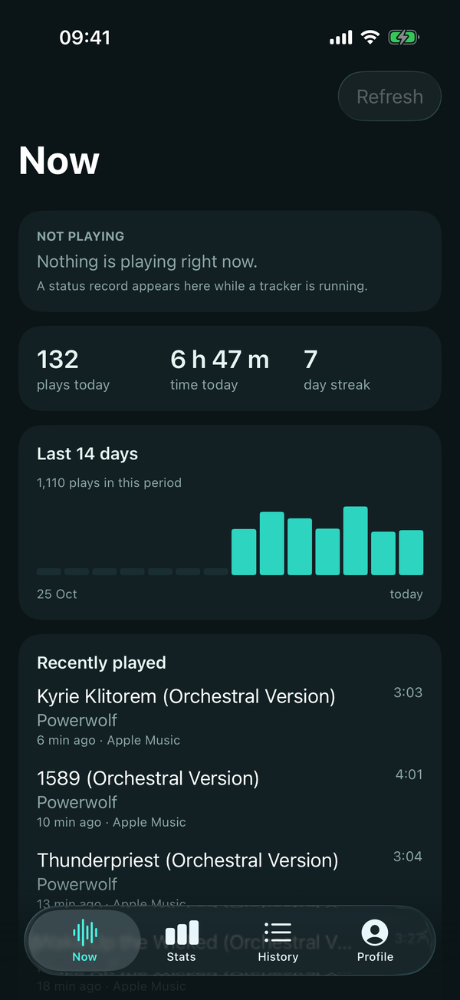
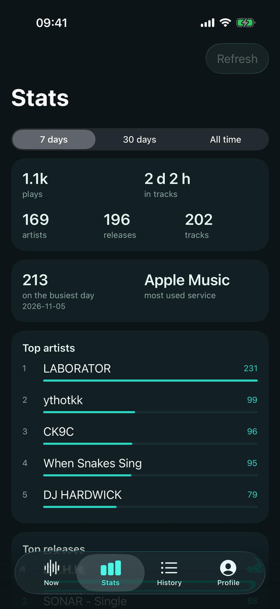
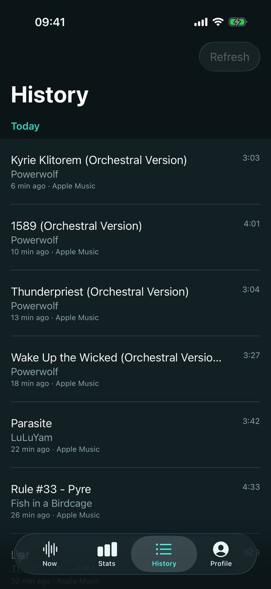
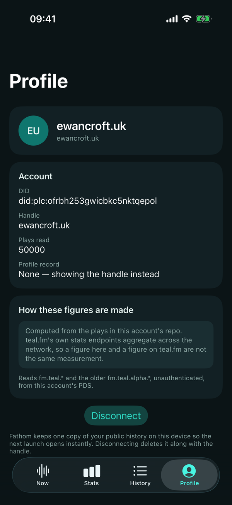

<p align="center">
  
</p>

<p align="center">
  <a href="https://github.com/ewanc26/fathom/actions/workflows/ci.yml"></a>
  <a href="LICENSE"></a>
  <a href="https://github.com/sponsors/ewanc26"></a>
</p>

# Fathom

A native teal.fm client for iOS and Android.

Fathom reads the plays already in your AT Protocol repo and turns them into a
listening dashboard: what is playing now, what today has been, top artists,
releases and tracks over 7 days, 30 days or all time, and the full history
grouped by the day you actually had.

It is a **reader**. It never writes a record, never asks for a password and
never holds a token.

## The name

A fathom is a unit of depth, and to fathom something is to understand it. Both
meanings fit: Fathom measures a listening history and makes the record
underneath it legible, while leaving that record in your own repository.

## Status

Read-only, and new. I would rather say so plainly.

- **The dashboard works end to end.** All four screens draw from a full read of a real account, a second launch opens from the saved copy, and the reading banner can be dismissed while the read continues behind it.
- **The figures are honest by construction.** A read that ends early is labelled partial rather than passed off as complete, and the runaway guard stops at 50,000 plays.
- **Both channels are live, neither app has been run on a device.** Fathom 0.2.1 is distributed through AltStore Classic and a self-hosted F-Droid repo. Everything verified is Android emulator and iOS simulator; no physical-device smoke test has been done. The Android APK is signed with the Fathom release key. The AltStore IPA is intentionally unsigned because AltStore Classic re-signs it with the user's Apple ID.
- **The write path is planned, not started.** Live scrobbling — OAuth, play qualification, an outbound queue and the controls that come with them — is designed in the issue tracker. Nothing here writes yet.

The changelog is in [CHANGELOG.md](CHANGELOG.md), the conventions and the
decisions behind them in [AGENTS.md](AGENTS.md), and the open work in the
[issue tracker](https://github.com/ewanc26/fathom/issues).

## Why it reads your repo rather than an AppView

teal.fm's custom lexicons describe plays, profiles and statuses, and their
records live in each person's own PDS. The hosted AppViews are not reliably
deployed — when this was written, one public host answered
`fm.teal.actor.getStatus` and 404'd every `fm.teal.stats.*` route — so a
dashboard built on those endpoints would be a dashboard that mostly does not
load.

Every play is in the repo, so Fathom reads `com.atproto.repo.listRecords` from
the account's PDS and aggregates on the device, a hundred records at a time,
until the repo runs out. Reading all of it is what makes "All time" a total
rather than the newest slice. A page costs about half a second on a real data
server, so a long history would be minutes of waiting: the dashboard opens on
the newest page and its figures grow as the rest arrives. A runaway guard stops
at 50,000 plays, and a read that ends early is labelled partial rather than
passed off as complete. See [`docs/PROTOCOL.md`](docs/PROTOCOL.md) for the
research behind reading the repo at all.

## Repository structure

| Directory | Purpose |
|-----------|---------|
| `shared/` | Kotlin Multiplatform core: lexicon record models, tolerant JSON decoding, XRPC construction, and all of the statistics. Consumed by Android as a Gradle module and by iOS as an XCFramework. |
| `Android/` | Android client (Kotlin, Compose, Material 3). Also the only Gradle root. |
| `iOS/` | iOS client (SwiftUI), with a generated Xcode project. |
| `lexicons/` | The `fm.teal.*` lexicons, vendored from [teal-fm/teal](https://github.com/teal-fm/teal) unmodified. |
| `website/` | The public landing page, privacy policy, terms, client metadata and icon, served by Vercel. |
| `tools/release/` | Local publisher for F-Droid, AltStore and GitHub Releases, plus manifest, SBOM and source validation helpers. |
| `docs/` | Protocol research, architecture and the dashboard's design. |
| `.github/workflows/` | CI and the release provenance workflow. |

## Features

- **Now** — what is playing, from the account's `fm.teal.actor.status` record,
  including whether it has expired; today's plays, today's time and the current
  day streak; a fourteen-day bar chart; the four most recent plays. The status
  is re-read once a minute while the app is in the foreground and no history
  read is running, so an expired card stops claiming a track is playing.
- **Stats** — plays, time in tracks, artists, releases and tracks for 7 days,
  30 days or all time; the busiest day and the most used service; top artists,
  releases and tracks, each with a share of the leader.
- **History** — every play read, grouped by the local day, with relative times
  and the length each record declared. Plays with no readable timestamp are
  listed under **No date** with their count, not silently dropped.
- **History search** — case- and diacritic-insensitive search over track,
  artist and release, folded once in the shared core. A blank query is the
  full history; a match count distinguishes a query with no matches from an
  account with no plays. A month menu jumps to the first play in any month the
  results contain.
- **Profile** — the teal.fm profile record, featured item, DID, and a plain
  statement of where the figures come from.
- **About** — the version and build number from the actual bundle, the source
  repository, the AGPL-3.0 text bundled for offline reading, third-party
  notices, and links to the privacy policy and terms.
- **Saved history** — a completed read is written to app-private storage, so a
  second launch draws the dashboard immediately and refreshes behind it. A
  complete saved copy is also the stopping point for an incremental read: only
  pages newer than the saved tail are fetched. The file is excluded from device
  backups. A saved copy keeps the read's completeness label, so a partial
  history is still labelled partial when it reopens.
- **Refresh** — pull down on any screen, or use the Refresh action, to read new
  plays since the saved copy. A refresh that stops on the first known page does
  not flash the reading banner. Profile's **Read everything** re-scans the whole
  history after an edit, deletion or backfill. The figures already on screen
  stay while the new read arrives.
- **Background reads** — the dashboard fills in as pages arrive, and the reading
  banner can be dismissed without stopping the read. The next read brings the
  banner back.
- **Resilient paging** — transient PDS rate limits, 5xx responses and network
  drops are retried three times with bounded, jittered backoff and
  `Retry-After`; a rejected page (400) keeps what was read and labels the
  history partial, while a 404 still means an empty namespace.
- **Record identity** — each play keeps the AT URI of its record, so
  overlapping pages and restored caches are deduplicated; two plays of the
  same track at different times still count twice.
- Reads both `fm.teal.*` and the pre-migration `fm.teal.alpha.*` namespace, so
  an account mid-migration keeps its older history.
- Works for any account on any PDS: the DID is resolved through the PLC
  directory and the records are read from that account's own data server.

## Screens

The four screens on iOS, captured from the simulator against a real account.
Android draws the same information with Material 3 components.

| Now | Stats | History | Profile |
|:---:|:---:|:---:|:---:|
|  |  |  |  |

## Building

### Android

```bash
cd Android
./gradlew assembleDebug
```

Requires JDK 17–23 (Gradle 8.13 refuses newer), Android SDK 36, and
`local.properties` with `sdk.dir`. Run the shared core's tests with:

```bash
./gradlew :shared:jvmTest
./gradlew :app:testDebugUnitTest
```

`./gradlew test` does not run the shared tests: the KMP JVM target exposes
`jvmTest`, not `test`, so the aggregate task skips `:shared`.

### iOS

```bash
./scripts/build-xcframework.sh     # once, and after any shared/ change
cd iOS && xcodegen generate
open Fathom.xcodeproj
```

`JAVA_HOME` must point at a JDK the Gradle version supports. The Xcode project
and the XCFramework are build products and are gitignored; `project.yml` is the
source.

## Interoperability

Fathom reads; it publishes nothing, so it owns no lexicon namespace. The
collections it reads are teal.fm's own:

| Collection | Use |
|------------|-----|
| `fm.teal.feed.play` | Plays |
| `fm.teal.actor.profile` | The dashboard's profile header |
| `fm.teal.actor.status` | Now playing |
| `fm.teal.alpha.*` | The same three, before the migration |

## Design

Dark-only, teal, and built around one number per tile. The palette is chosen
against a deep surface and a light mode would be a second design rather than a
recolour, so there is only the one. Avatars are monograms: Fathom deliberately
does not fetch blobs, which keeps the dashboard to one kind of network request
and avoids decoding arbitrary images.

<p align="center">
  
  &nbsp;&nbsp;&nbsp;
  
</p>

The mark is the dashboard's own chart: five bottom-aligned bars, the tallest in
mint. The launch screen carries the same bars without the tile, and both are
drawn from one set of coordinates in `scripts/gen-icon.py`.

[`docs/DESIGN.md`](docs/DESIGN.md) covers the screens and the decisions in
them.

## Testing

- `shared/src/commonTest/` holds the real coverage: timestamp parsing and UTC
  bucketing, AT URI validation and record-level deduplication, incremental
  stop/merge rules, query encoding, tolerant record decoding, the statistics
  themselves and History search. The search tests cover case, diacritics,
  legacy artist names, releases and multi-word queries on both platforms.
- `iOS/FathomTests/` covers the Swift-facing facade — that the bridge still
  carries a play, a page and a computed figure.
- Android has a JVM suite for the transport's retry and error paths and the
  repository's partial/absent paging (`:app:testDebugUnitTest`, run by CI);
  everything worth testing about the figures is in the shared core.

Both apps have been run against a real account (`ewancroft.uk`) on an Android
emulator and an iOS simulator. That run is what found a facade method that
called itself and crashed the first network read, and what established that
the account holds more than the 50,000-play guard: the read stops there, the
screens say the figures are partial, and the saved copy keeps that label.

The iOS account run lives in `iOS/FathomUITests/` and in the `FathomAccount`
scheme, separate from the default scheme because it needs the public network
and about five minutes.

## Releases

The version and build number live in [`version.properties`](version.properties).
Android reads that file directly; iOS is synchronised into `project.yml` and
`Info.plist` by `python3 scripts/sync-version.py`, and CI rejects drift. Every
uploaded build must raise `versionCode`, which is also the iOS build number.

Releases follow the same split as Inkwell. The Android APK and the unsigned
AltStore Classic IPA are built locally. The publisher adds the APK to the
self-hosted F-Droid repo, updates the AltStore source and website, and attaches
both binaries to one unified `v<version>` GitHub Release. GitHub Actions never
receives a signing key. The [Release provenance](.github/workflows/release.yml)
workflow only adds SPDX SBOMs, a hashed release manifest and build-provenance
attestations for the manifest and SBOMs. The AAB is a Play upload artefact, not
a release asset.

The local publisher is dry-run by default:

```bash
node tools/release/publish.mjs status
node tools/release/publish.mjs android --yes --push --notes-file release-notes.md
node tools/release/publish.mjs ios --yes --push
```

`ios` builds the unsigned AltStore IPA itself. `--ipa` remains available for an
App Store export when that channel is added. Fathom 0.2.1 is available from
[AltStore Classic and F-Droid](https://fathom.ewancroft.uk/#install). The
older debug preview at
[preview-0.2.0](https://github.com/ewanc26/fathom/releases/tag/preview-0.2.0)
predates the contract and is not a release. See
[`RELEASE_PROCESS.md`](RELEASE_PROCESS.md) for local signing, provenance
verification, store handoff and rollback.

The public site lives in [`website/`](website/). Vercel deploys it from the
repository, serving that directory through [`vercel.json`](vercel.json) with no
build step at `https://fathom.ewancroft.uk`. The custom domain is live; the
`fathom-app` project URL remains a fallback. See
[`website/README.md`](website/README.md). The site has no JavaScript, no
analytics and no third-party requests.

## Limitations

- **Read-only.** There is no scrobbling, no profile editing and no status
  writing. `website/client-metadata.json` records the scopes those would need.
- **Long first loads.** The history is read a hundred plays at a time, so an
  account with tens of thousands of plays takes minutes to read the first
  time; the dashboard opens on the newest page and counts the plays it has
  reached while the rest arrive. Later launches open from the saved copy and
  usually need only the pages above its tail. The guard stops a full read at
  50,000 plays, and anything read short of the end is labelled partial.
- **Incremental refresh trusts the saved tail.** A record edited or deleted
  below that tail is only picked up by **Read everything**; ordinary refresh is
  for new plays, not a rewritten repo.
- **No App Store or Play listing.** The first channels are AltStore Classic
  and a self-hosted F-Droid repo, not the official stores. Play internal
  testing and TestFlight still need their app records, signing certificates
  and manual uploads. The Android debug preview is a development build, not a
  substitute for a release.
- **Figures are local.** They are computed from this repo, not from teal.fm's
  network-wide stats endpoints, and the two are not the same measurement.
- **No OAuth.** None is needed to read, and a half-implemented flow would be
  worse than none.

## Contributing

[AGENTS.md](AGENTS.md) is the architectural contract; read it before changing
anything, and keep it aligned with the code. Conventional Commits, scoped by
area: `feat(android): …`, `fix(shared): …`, `docs(protocol): …`. British
English in prose and UI copy. The
[issue tracker](https://github.com/ewanc26/fathom/issues) holds the open work:
pick an issue, branch from `main`, and open a pull request.

## Support

If you find this project useful, consider supporting its development:

[](https://ko-fi.com/ewancroft)
[](https://github.com/sponsors/ewanc26)

## Licence

Fathom is licensed under the GNU Affero General Public License v3.0. See
[LICENSE](LICENSE).

## Star History

<a href="https://www.star-history.com/?repos=ewanc26%2Ffathom&type=date&legend=bottom-right">
 <picture>
   <source media="(prefers-color-scheme: dark)" srcset="https://api.star-history.com/chart?repos=ewanc26/fathom&type=date&theme=dark&legend=bottom-right" />
   <source media="(prefers-color-scheme: light)" srcset="https://api.star-history.com/chart?repos=ewanc26/fathom&type=date&legend=bottom-right" />
   
 </picture>
</a>
